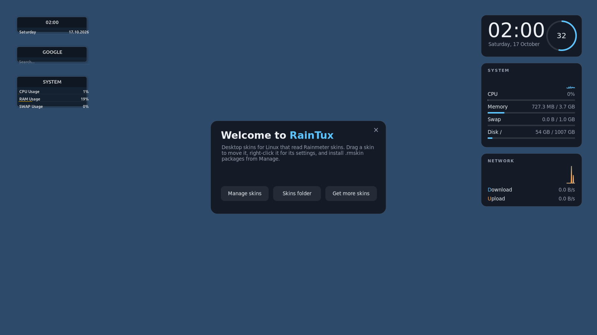

# RainTux

**Rainmeter skins on the Linux desktop.** RainTux reads Rainmeter `.ini` skins and `.rmskin`
packages and draws them as desktop widgets on Wayland (Sway, Hyprland, KDE Plasma, river,
Wayfire, niri, labwc, COSMIC…). It follows Rainmeter's own behaviour: one ordered update cycle
per skin, the same option syntax, bangs, section variables, mouse actions, layouts and the
right-click menu you know from Windows.



## Install

```bash
curl -fsSL https://raw.githubusercontent.com/H4R13/Rain-Tux/main/install.sh | bash
```

The installer is RainTux's `setup.exe`: it installs the system packages (GTK 4, PyGObject,
gtk4-layer-shell — built from source on distros that don't ship it), downloads RainTux from
GitHub into `~/.local/share/raintux`, creates a Python environment, adds RainTux to the app
menu, registers `.rmskin` files so double-clicking one installs it, and starts RainTux at login.
Options: `--branch NAME`, `--yes`, `--no-system-packages`, `--no-autostart`, `--uninstall`.
To try a branch before it is merged:

```bash
curl -fsSL https://raw.githubusercontent.com/H4R13/Rain-Tux/feat/rainmeter-parity/install.sh | bash -s -- --branch feat/rainmeter-parity
```

Supported: Ubuntu 24.04+, Debian 13+, Fedora 39+, Arch, openSUSE Tumbleweed (Python 3.11+, GTK 4.12+).

Manual install from a checkout:

```bash
python3 -m venv --system-site-packages .venv      # PyGObject + pycairo from your distro
.venv/bin/pip install -e .
.venv/bin/python -m raintux
```

## Using it

| Rainmeter | RainTux |
|-----------|---------|
| Tray icon → Manage | Tray icon (left click) or the **RainTux** app-menu entry opens **Manage** |
| Manage: Skins / Layouts / Settings / About-Log | Same tabs: load variants, position, transparency, zoom, toggles; save/load layouts; start at login; log |
| Right-click a skin | Same menu: Variants, Settings (Position, Transparency, Hide on mouse over, Draggable, Save position, Snap to edges, Click through, Keep on screen), custom `ContextTitle` items, Manage / Edit / Refresh / Unload skin |
| Drag skins, snapping to edges and other skins | Same (Ctrl + right-click always opens the menu) |
| Install `.rmskin` (double-click) | Double-click, `raintux file.rmskin`, or **Install skin…** in Manage. Existing skins are backed up to `Skins/@Backup`, `VariableFiles` keep your values, layouts and fonts are installed |
| `Rainmeter.exe !Bang …` | `raintux '!Bang' args…` talks to the running instance |

Skins live in `~/RainTux/Skins/<Suite>/<Config>/<Skin>.ini`, exactly like `Documents\Rainmeter\Skins`.
The first launch loads the bundled **RainTux** suite (Welcome, Clock, System, Network).

## What is supported

Practically everything a skin uses on Windows, implemented natively (details in
[docs/COMPATIBILITY.md](docs/COMPATIBILITY.md)):

- **Syntax**: `@Include` (in place), `[Variables]` with `#Var#`, `#*Escapes*#`, built-ins
  (`#CURRENTCONFIG#`, `#@#`, `#SKINSPATH#`, `#SCREENAREAWIDTH@2#`…), formulas in parentheses
  (all Rainmeter operators and functions), `MeterStyle`, `DynamicVariables`, `UpdateDivider`,
  `Group`, `Container`, `TransformationMatrix`, UTF-16 skins, case-insensitive Windows paths.
- **Section variables**: `[Measure]`, `[Measure:]`, `[Measure:%]`, `[Measure:/1024,2]`,
  `[Measure:MaxValue]`, `[Meter:X/Y/W/H/XW/YH]`, `[#Var]`, `[&Measure]`, `[&Script:Func()]`,
  `[%ENV]`, `[$SkinX]`, `[$MouseX]`, `[\x263A]`, and `$MouseX$`/`$MouseY:%$` in mouse actions.
- **Meters**: String (InlineSetting, ClipString, StringEffect, Angle, AccurateText), Image
  (scaling modes, 9-slice, tile, crop, flip, rotate, tint, greyscale, ColorMatrix, MaskImageName),
  Bar, Shape (rectangles, ellipses, lines, arcs, curves, paths, gradients, dashes, transforms,
  Combine), Roundline, Rotator, Histogram, Line, Button, Bitmap, **TextEdit** and **Svg**.
- **Measures**: CPU, PhysicalMemory/SwapMemory/Memory, FreeDiskSpace, NetIn/NetOut/NetTotal, Time,
  Uptime, Calc, String, Loop, Script (**Lua**, with the SKIN/SELF API), WebParser, ActionTimer,
  NowPlaying (any MPRIS player: Spotify, VLC, browsers…), Audio volume (PipeWire/PulseAudio),
  AudioLevel (visualizers), Power (battery), SysInfo, Process, RunCommand, Ping, UsageMonitor,
  WifiStatus, CoreTemp/SpeedFan, FolderInfo, FileView, Quote, RecycleManager (desktop trash),
  InputText, Mouse, DragDrop, MediaKey — both `Measure=X` and the old `Plugin=X.dll` forms.
- **Measure options**: MinValue/MaxValue, InvertMeasure, AverageSize, Substitute (also RegExp),
  IfCondition/IfTrueAction/IfFalseAction, IfAbove/Below/Equal, IfMatch, OnChangeAction,
  OnUpdateAction, Disabled/Paused.
- **Bangs**: the full set, including `!SetOption`, `!SetVariable` (with formulas),
  `!WriteKeyValue`, `!CommandMeasure`, `!Delay`, `!UpdateMeter *`, groups, `!ActivateConfig`,
  `!LoadLayout`, `!Move`, `!ZPos`, `!SetTransparency`, `!ShowFade`, mouse-action
  enable/disable, `!SetZoomFactor`, and current namespaced bangs like `!ActionTimer:Execute 1`,
  `!TextEdit:Clear`, `!Skin:Load`, `Group=` targets.
- **Window behaviour**: AlwaysOnTop levels (on desktop → stay topmost), click-through,
  transparent pixels click through, draggable with snapping, keep on screen, fades,
  multi-monitor positions, per-skin zoom.

Not possible on Linux: Windows-only plugin DLLs (packages that ship them still install; those
measures return 0), `Measure=Registry`, `PerfMon`, `ResMon`, `WindowMessage`, desktop blur.

## Compositors

| Desktop | Result |
|---------|--------|
| Sway, Hyprland, river, Wayfire, niri, labwc, COSMIC, KDE Plasma (Wayland) | Full desktop widgets via **wlr-layer-shell** (on the desktop, below or above windows) |
| GNOME (Wayland) | GNOME gives apps no desktop layer: skins appear as normal borderless windows. The tray icon needs the AppIndicator extension. |
| X11 sessions | Runs as normal windows (positioning is up to the window manager) |

RainTux re-launches itself once with `LD_PRELOAD` pointing at gtk4-layer-shell, which has to load
before libwayland (opt out: `RAINTUX_NO_PRELOAD=1`). Programs launched by skins don't inherit it.

## Command line

```bash
raintux                              # start (or open Manage when already running)
raintux --manage 'illustro\Clock'
raintux ~/Downloads/some.rmskin      # install a package
raintux '!ActivateConfig' 'illustro\Clock' 'Clock.ini'
raintux '!SetVariable' Color '255,0,0' 'RainTux\Clock'
raintux --refresh-all
```

## Files

| What | Where |
|------|-------|
| Skins | `~/RainTux/Skins/` (also `~/.local/share/raintux/skins`) |
| Layouts | `~/RainTux/Layouts/<Name>/` |
| Loaded skins and positions (Rainmeter.ini) | `~/.config/raintux/skins.json` |
| Settings | `~/.config/raintux/config.toml` |
| Downloads (WebParser, covers) | `~/.cache/raintux/` |

## Local API and web Skin Manager

A small API on `127.0.0.1:7272` (toggle in Manage → Settings) lets scripts and the optional web
Skin Manager in `ui/` drive RainTux: `GET /skins`, `GET /skins/active`,
`POST /skins/{id}/load|unload|refresh`, `GET|PUT /skins/{id}/config`, `POST /bang`
(`{"bang": "!Refresh illustro\\Clock"}`), `GET /system/status`, `WS /ws`.
Run the web UI with `cd ui && npm install && npm run dev`.

## Development

```bash
python -m pytest            # 100+ tests; they run without a display (GTK-free core)
RAINTUX_DEV=1 python -m raintux
```

The core (`raintux/core`, `raintux/measures`, `raintux/meters`) has no GTK dependency; the desktop
side (`raintux/core/engine.py`, `raintux/wayland`, `raintux/gui`) implements the `SkinHost`
interface. `tests/helpers.py` loads skins headlessly for tests.

## License

MIT. The bundled RainTux skins are MIT as well. Rainmeter is a separate GPL-2.0 project;
RainTux shares no code with it.
